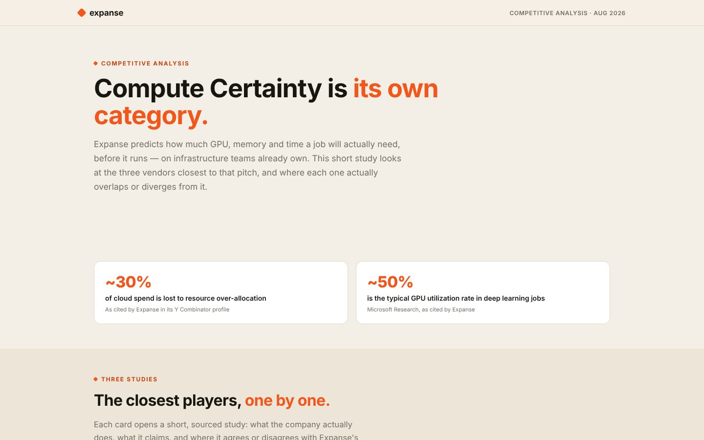
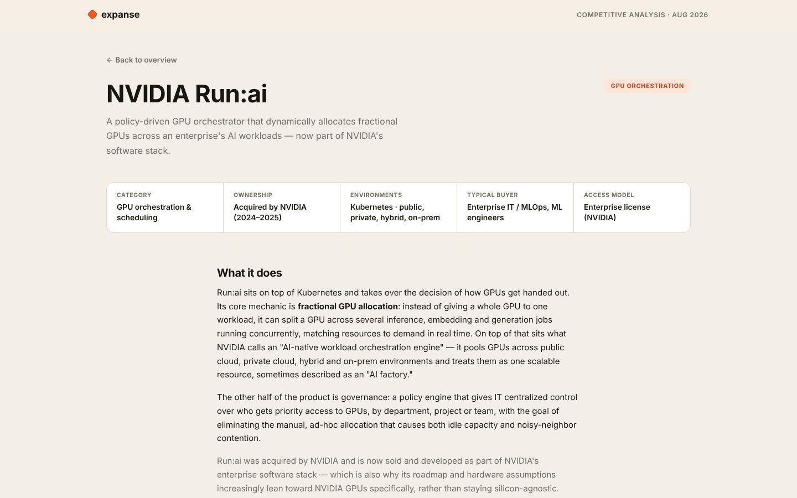
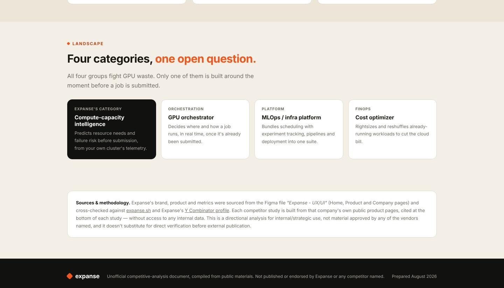
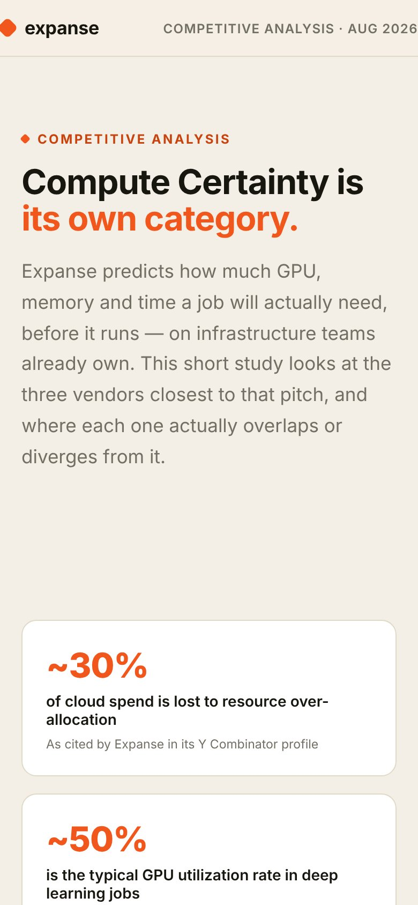

# Expanse — Competitive Analysis

A short, sourced competitive study of Expanse, which predicts how much GPU, memory and time a job will need before it runs, compared with the three vendors closest to its pitch: NVIDIA Run:ai, ClearML and CAST AI.

**Live:** [expanse-competitive-analysis.vercel.app](https://expanse-competitive-analysis.vercel.app)



## What's inside

| Section | What it shows |
| --- | --- |
| **Overview** | Expanse's category ("Compute Certainty") and two market figures as cited by Expanse. |
| **The closest players** | A card per competitor with its category, a one-line summary and its own claimed results. |
| **Competitor studies** | NVIDIA Run:ai (GPU orchestration), ClearML (MLOps platform) and CAST AI (Kubernetes FinOps), each with a snapshot, what it does, claimed results, where it overlaps with Expanse, where it differs, a head-to-head comparison and sources. |
| **Landscape** | Four categories fighting GPU waste, and where Expanse sits among them. |
| **Sources & methodology** | Where the data comes from and the limits of the analysis. |

<table>
  <tr>
    <td></td>
    <td></td>
  </tr>
  <tr>
    <td colspan="2" align="center"></td>
  </tr>
</table>

Each study is built from the vendor's own public product pages, cited at the bottom of the study. It is a directional analysis, not material approved by any of the vendors named.

## Built with

- Plain **HTML** and **CSS**, with a few lines of vanilla **JavaScript** for hash-based navigation between the overview and the studies
- **Inter** from Google Fonts
- Deployed on **Vercel**

## Project structure

```
.
├── index.html    # overview and the three studies: markup, styles and script
├── favicon.svg
├── docs/         # screenshots used in this README
└── README.md
```

## Run locally

No install needed. Open `index.html` in a browser, or serve the folder:

```bash
npx serve .
```

Each study has its own link: `#runai`, `#clearml`, `#castai`.

## Contact

- [LinkedIn](https://www.linkedin.com/in/fl%C3%A1vio-veloso-a29b02254/)
- [X @flaviovlso](https://x.com/flaviovlso)
- [github.com/flaviohcveloso](https://github.com/flaviohcveloso)

---

© 2026 Flávio Veloso. All rights reserved.
